**Status:** pierwszy diagram logiczny, do wspólnej weryfikacji  
**Silnik docelowy:** MariaDB / InnoDB

Diagram pokazuje główne encje i relacje. Nie jest jeszcze finalnym DDL. Krotności opisują relacje logiczne; opcjonalność niektórych FK zostanie doprecyzowana przy tworzeniu SQL.

```mermaid
erDiagram
    USERS ||--o{ USER_ROLES : has
    ROLES ||--o{ USER_ROLES : assigned
    USERS ||--o| EMPLOYEES : represents

    EMPLOYEES ||--o{ EMPLOYEE_ASSIGNMENTS : has
    DEPARTMENTS ||--o{ EMPLOYEE_ASSIGNMENTS : includes
    DEPARTMENTS o|--o{ DEPARTMENTS : parent_of

    EMPLOYEES ||--o{ EMPLOYEE_CHILDREN : linked
    CHILDREN ||--o{ EMPLOYEE_CHILDREN : linked
    EMPLOYEE_CHILDREN ||--o{ CHILD_VERIFICATIONS : verified

    BENEFIT_TYPES ||--o{ BENEFIT_PERIODS : defines
    BENEFIT_TYPES ||--o{ ELIGIBILITY_RULES : configures
    BENEFIT_TYPES ||--o{ BENEFIT_REQUIRED_DOCUMENTS : requires
    DOCUMENT_TYPES ||--o{ BENEFIT_REQUIRED_DOCUMENTS : selected

    EMPLOYEES ||--o{ APPLICATIONS : submits
    BENEFIT_TYPES ||--o{ APPLICATIONS : classifies
    BENEFIT_PERIODS ||--o{ APPLICATIONS : covers
    APPLICATION_STATUSES ||--o{ APPLICATIONS : current_status

    APPLICATIONS ||--o{ APPLICATION_HISTORY : records
    APPLICATION_STATUSES o|--o{ APPLICATION_HISTORY : previous_status
    APPLICATION_STATUSES ||--o{ APPLICATION_HISTORY : new_status
    USERS ||--o{ APPLICATION_HISTORY : changes

    APPLICATIONS ||--o{ APPLICATION_VERSIONS : versioned
    USERS ||--o{ APPLICATION_VERSIONS : edits

    APPLICATIONS ||--o{ APPLICATION_DOCUMENTS : tracks
    DOCUMENT_TYPES ||--o{ APPLICATION_DOCUMENTS : identifies
    USERS o|--o{ APPLICATION_DOCUMENTS : registers_or_verifies

    EMPLOYEES ||--o{ COMMISSION_MEMBERS : serves
    COMMISSION_MEMBERS ||--o{ APPLICATION_REVIEWS : reviews
    APPLICATIONS ||--o{ APPLICATION_REVIEWS : reviewed

    APPLICATIONS ||--o{ DECISIONS : receives
    USERS ||--o{ DECISIONS : records

    BENEFIT_PERIODS ||--o| BENEFIT_BUDGETS : has
    BENEFIT_BUDGETS ||--o{ BUDGET_TRANSACTIONS : ledger
    DECISIONS o|--o{ BUDGET_TRANSACTIONS : may_generate

    USERS ||--o{ IMPORT_BATCHES : starts
    IMPORT_BATCHES ||--o{ IMPORT_ROWS : contains
```

## Encje i ich odpowiedzialności

| Obszar | Encje | Odpowiedzialność |
|---|---|---|
| Konta i uprawnienia | `users`, `roles`, `user_roles` | Logowanie i role aplikacyjne |
| Kadry i organizacja | `employees`, `departments`, `employee_assignments` | Dane pracowników i ich przypisania |
| Dzieci | `children`, `employee_children`, `child_verifications` | Minimalna ewidencja danych potrzebnych do sprawdzenia kryteriów |
| Katalog świadczeń | `benefit_types`, `benefit_periods`, `eligibility_rules` | Rodzaje świadczeń, okresy i reguły |
| Wnioski | `applications`, `application_statuses`, `application_history`, `application_versions` | Cykl życia wniosku, historia i wersje |
| Dokumenty | `document_types`, `benefit_required_documents`, `application_documents` | Wymagania i statusy dostarczenia/weryfikacji |
| Komisja | `commission_members`, `application_reviews`, `decisions` | Członkostwo, przegląd wniosków i decyzje |
| Finanse | `benefit_budgets`, `budget_transactions` | Budżet i historia jego obciążenia |
| Import | `import_batches`, `import_rows` | Ślad importowania danych pracowników |

## Istotne uwagi do weryfikacji przed SQL

1. **Powiązanie dziecka z dwojgiem pracowników:** relacja N:M jest zaprojektowana, ale trzeba ustalić bezpieczny sposób rozpoznawania, że dwa wpisy dotyczą tego samego dziecka. Sama data urodzenia nie wystarcza jako identyfikator.
2. **Wersje wniosku:** `application_versions` jest dodane jako osobna encja, ponieważ ponowne złożenie poprawionego wniosku nie może nadpisywać treści wcześniej rozpatrywanej przez komisję.
3. **Wymagane dokumenty:** konfiguracja `benefit_required_documents` musi zostać skopiowana/zamrożona dla konkretnego wniosku przy jego utworzeniu lub złożeniu. W przeciwnym razie późniejsza zmiana konfiguracji zmieniłaby wymagania historycznych spraw.
4. **Członek komisji a administrator:** członkostwo w komisji (`commission_members`) jest odrębne od roli aplikacyjnej (`roles`). To różne pojęcia.
5. **Decyzje:** relacja `applications` 1:N `decisions` pozostaje robocza. Pozwala zachować ponowne rozpatrzenia, ale reguły ich tworzenia muszą być określone.
6. **Budżet:** `budget_transactions` ma być rejestrem zdarzeń finansowych. Saldo wyliczamy z transakcji, a nie przez ręczne nadpisywanie pola „pozostało”.
7. **Reguły kwalifikacyjne:** `eligibility_rules` opisuje konfigurację reguł. Wyniki sprawdzenia dla konkretnego wniosku powinny być zapisywane osobno, jeśli potrzebujemy odtworzyć, dlaczego system oznaczył wniosek jako spełniający/ niespełniający kryteria według reguł obowiązujących w danym czasie.

## Co sprawdzimy jako pierwsze

- Czy `users` i `employees` powinny być połączone relacją 1:0..1.
- Czy pracownik może mieć więcej niż jedno konto (wstępnie: nie).
- Czy jeden okres świadczeniowy ma dokładnie jeden budżet (wstępnie: tak).
- Czy wniosek może mieć wiele decyzji (wstępnie: tak, dla zachowania historii).
- Jak zapisać wynik automatycznej oceny kryteriów i wersję reguł użytych przy ocenie.
- Czy konfiguracja dokumentów jest kopiowana do wniosku jako snapshot, czy wersjonowana przez odwołanie do konkretnej wersji konfiguracji.

## Zasada integralności

Klucze obce będą pilnować, żeby rekordy podrzędne wskazywały istniejące rekordy nadrzędne. MariaDB/InnoDB obsługuje takie ograniczenia; przy DDL dobierzemy również jawne reguły `ON DELETE` i `ON UPDATE`, zamiast polegać na przypadkowych wartościach domyślnych. Zob. [MariaDB: Foreign Key Constraints](https://mariadb.com/docs/server/architecture/server-constraints/foreign-key-constraints).
"""